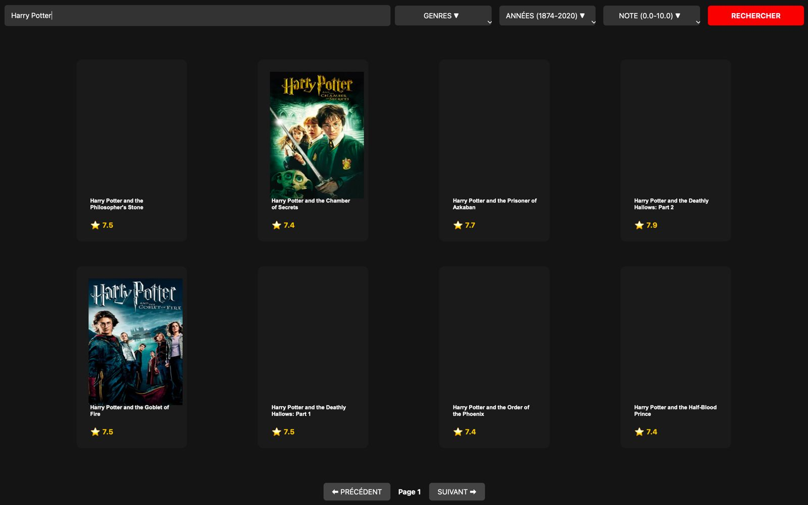
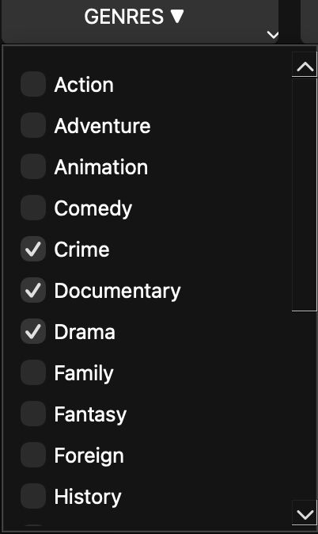
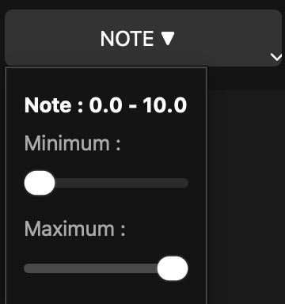
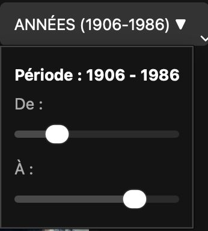
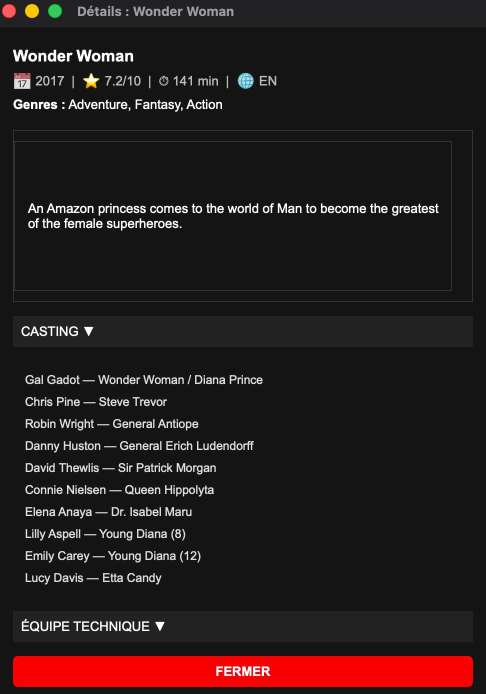

# MyStream BDD

**MyStream BDD** est une application d'exploration cinématographique fluide, moderne et intuitive. Elle permet de parcourir, rechercher et analyser une vaste collection de films avec une expérience utilisateur optimale.



---

## 🌟 Fonctionnalités

### 1. Recherche et Filtrage Puissants
Trouvez instantanément vos films préférés grâce à nos outils combinables :
*   **Recherche** par titre.
*   **Filtres dynamiques** : genre, période (année) et note minimale.

<p align="center">
  
  
  
</p>

### 2. Fiches Détaillées
Accédez à toutes les informations essentielles en un clic :
*   Synopsis et date de sortie.
*   **Casting complet** et équipe technique.
*   Score et statistiques.



---

## 🚀 Installation

Suivez ces étapes pour lancer le projet localement.

### Prérequis
*   **Python 3.x**
*   **PostgreSQL**

### Configuration
```bash
# 1. Cloner le projet
git clone https://gitlab.sorbonne-paris-nord.fr/404found/projet_site_streambdd.git
cd projet_site_streambdd

# 2. Installer les dépendances
python3 -m venv venv
source venv/bin/activate  # Windows: venv\Scripts\activate
pip install PyQt6 psycopg2-binary requests
```

### Base de Données
```bash
# 1. Créer la base
createdb streambdd
psql -d streambdd
```

Dans l'invite SQL, importez les données dans cet ordre précis :
```sql
\i Projet_SQL/movie_database.sql
\i Projet_SQL/insert_files/insert_genres.sql
\i Projet_SQL/insert_files/insert_keyword_list.sql
\i Projet_SQL/insert_files/insert_movies_total.sql
\i Projet_SQL/insert_files/insert_movie_genre.sql
\i Projet_SQL/insert_files/insert_movie_keywords.sql
\i Projet_SQL/insert_files/insert_cast.sql
\i Projet_SQL/insert_files/insert_crew.sql
\i Projet_SQL/insert_files/insert_ratings_final.sql
```

### Lancement
```bash
python3 Projet_SQL/stream_app.py
```

---

## 🛠 Technologies


## 👥 Auteurs
*   **Sanjai RAMALINGAME**
*   **Ismael BARRY**
*   **Kevin MADIVANANE**
